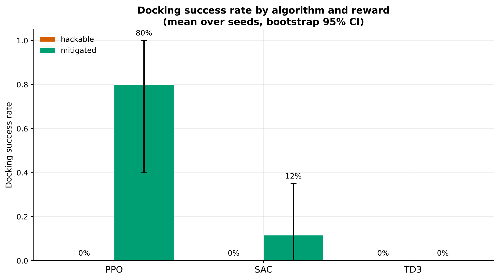

# Spacecraft-RL

A Gymnasium environment for spacecraft docking with 3D Clohessy-Wiltshire dynamics, and scripts that train PPO, SAC and TD3 on several reward functions to see which ones lead to docking. There is also a small lane-keeping environment with three rewards of the same names.



## Install

```
pip install -e ".[dev]"
```

## Run

```
bash reproduce.sh
```

This trains all agents, writes the records and statistics to `results/` and the figures to `figures/`. The scripts append to the records, so the script first moves any old `results/*.jsonl` files and `results/trajectories/` into `results/previous-<timestamp>/` (ignored by git). A failed rerun loses nothing. The records, `statistics.json` and `statistics_report.txt` of the run behind the paper are committed in `results/`. The evaluation trajectories are not, so `python -m experiments.visualize` skips the two trajectory figures on a fresh clone and builds the others from the committed records.

The environments can also be used on their own:

```python
import gymnasium, spacecraft_rl
# The experiments start the chaser 100 m from the target; the default is 500 m.
env = gymnasium.make("SpacecraftDocking-hackable-v0", initial_distance=100.0)
```

## Tests

```
pytest tests
```

## Paper

```
cd paper && pdflatex main.tex && pdflatex main.tex
```

## Citation

```bibtex
@misc{spacecraft_rl,
  author = {Guntikiwritescode},
  title  = {Spacecraft-RL: Misspecified Rewards in a Spacecraft Docking Task},
  year   = {2026},
  url    = {https://github.com/Guntikiwritescode/Spacecraft-RL}
}
```
