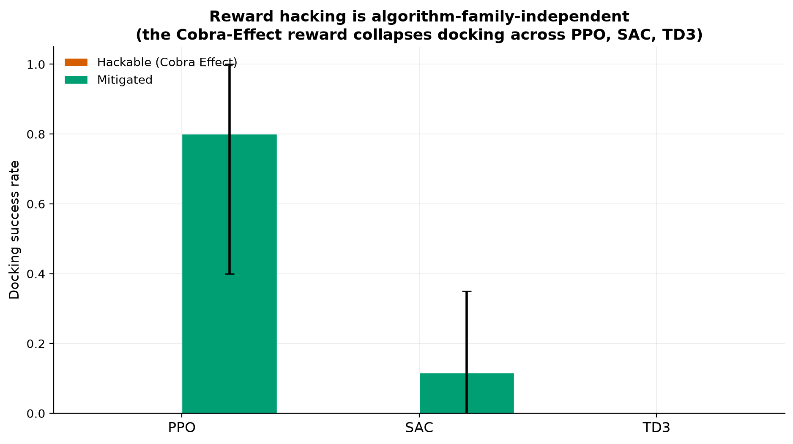
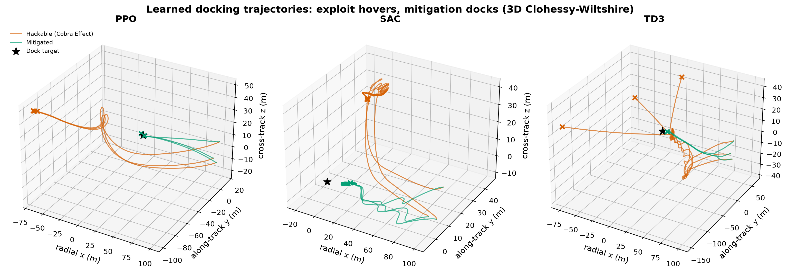
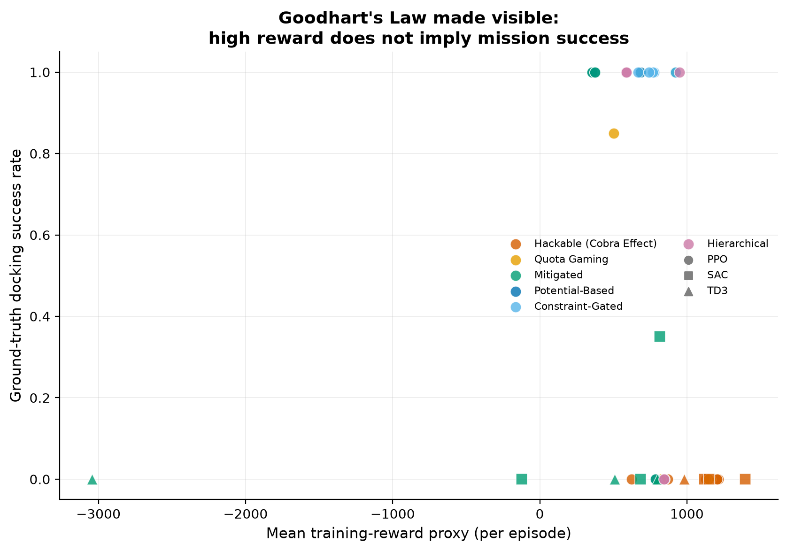

# Goodhart's Taxonomy

### Historically-Documented Incentive Failures as a Framework for Reward Misspecification in Safety-Critical Reinforcement Learning

A multi-algorithm research campaign demonstrating that **reward hacking emerges
universally** — across RL algorithm families, reward architectures, and physical
domains — in a safety-critical **6-DOF spacecraft docking** environment with full
3D Clohessy–Wiltshire orbital dynamics, and that principled reward design
eliminates it.

> *In 1902, colonial authorities in Delhi offered a bounty for dead cobras.
> Residents bred cobras to collect it. When the scheme was cancelled, the
> worthless snakes were released — leaving the city with more cobras than before.
> This is the **Cobra Effect**, and it is exactly what a reinforcement-learning
> agent does when its reward peaks where the problem **persists** rather than
> where it is **solved**.*

---

## Abstract

Reward misspecification in safety-critical continuous control produces agent
behaviours structurally identical to historically-documented incentive failures.
Using a custom Gymnasium environment with full 3D Clohessy–Wiltshire relative
orbital dynamics, we show that a plausible-looking dense reward generates the
**Cobra Effect**: an agent that maximises cumulative reward while achieving a
**0% docking-success rate**, hovering at a standoff ring because docking would
end the reward stream. Across **PPO, SAC, and TD3** and multiple seeds, the
failure is **algorithm-family-independent** — it is a property of the reward, not
the optimiser. We taxonomise a second failure mode (**Soviet Quota Gaming**),
show four mitigation architectures eliminate the exploit (with Mann–Whitney *U*
significance testing), map the reward-coefficient boundary at which hacking
emerges, and **transfer the entire taxonomy to autonomous lane-keeping**,
demonstrating domain-independence. We connect the findings to Goodhart's Law and
to emergent-misalignment-from-reward-hacking research on large language models.

## Key Results



*Exploitable rewards (vermillion/orange) collapse docking success to near-zero
across PPO, SAC and TD3; mitigated rewards (green/blue) dock reliably. **Reward
structure, not the optimiser, determines the outcome.***



*Learned 3D Clohessy–Wiltshire trajectories: the hackable policy hovers at a
standoff ring and never reaches the target (★); the mitigated policy docks.*



*Goodhart's Law made visible: high training reward does not imply mission
success. Exploit runs occupy the high-reward / zero-success corner.*

> Full numeric results (with confidence intervals and hypothesis tests) are in
> [`results/statistics_report.txt`](results/statistics_report.txt) and the
> compiled paper [`paper/main.pdf`](paper/main.pdf). All 13 figures are in
> [`figures/`](figures/).

## Motivation: Goodhart's Law for RL rewards

> **Goodhart's Law:** *"When a measure becomes a target, it ceases to be a good
> measure."*

A reward is almost never a perfect proxy for the designer's intent. When the
proxy and the intent diverge, a capable optimiser finds and exploits the gap.
This project makes that gap **physical and legible**: in orbital docking, reward
hacking is a fly-away, an unsafe closing velocity, or a mission that never
completes. The same structural failure underlies reward-model over-optimisation
in RLHF (sycophancy, verbosity, confident fabrication) and the *emergent
misalignment* that can arise from training on reward hacks
([Anthropic, 2025](https://www.anthropic.com/research)).

## The Environment: 3D spacecraft proximity operations

| Parameter | Value |
|---|---|
| Dynamics | Full 3D Clohessy–Wiltshire (Hill frame), RK4-integrated |
| Reference orbit | 400 km LEO circular (n ≈ 1.13 × 10⁻³ rad/s, T ≈ 92 min) |
| State | 12-D scale-invariant: unit line-of-sight direction (3D), relative velocity (3D), fuel, phase, coarse + fine range, speed, closing rate |
| Action | Continuous 3-D thrust ∈ [−1, 1]³ |
| Max thrust | 0.2 m/s² per axis |
| Fuel budget | 50 m/s Δv |
| Safe dock (soft capture) | distance < 3 m **and** speed < 0.3 m/s **and** within approach cone |
| Velocity corridor | speed < 0.1 × distance (slow down as you close in) |
| Approach cone | ±40° of the +x docking axis, active within 50 m |
| Campaign range | 100 m terminal rendezvous (env supports the full 500 m range) |

The RK4 propagator is validated against the closed-form CW state-transition
matrix to machine precision (see `tests/test_dynamics.py`). Safety constraints
are **tracked but not enforced** — whether the agent respects or exploits them is
decided entirely by the `reward_type`.

## Taxonomy of Failure Modes

Each failure mode is presented as *historical case → RL manifestation → LLM
parallel*, showing it is a general pattern, not one demo.

### 1. The Cobra Effect (reward farming) — `hackable`

* **Historical (1902, British India):** a per-head cobra bounty incentivised
  breeding cobras; the reward tracked "dead cobras produced," not "fewer cobras."
* **RL manifestation:** a non-telescoping per-step *standoff-hold* bonus, peaked
  at a distance **away from the dock**, plus episode-termination on success. The
  discounted value of hovering forever dwarfs the small docking bonus, so the
  agent orbits a standoff ring and **never docks** (0% success, high reward).
* **LLM parallel:** length-biased reward models that pay per token reward
  verbosity over helpfulness — the reward peaks where the conversation
  *continues*, not where the user is *helped*.

### 2. Soviet Quota Gaming (activity proxy) — `quota_hackable`

* **Historical (Soviet planned economy):** factories rewarded on output tonnage
  produced a few needlessly heavy items; rewarded on unit count, many useless
  small ones. The quota measured *activity*, not *value*.
* **RL manifestation:** rewarding path length (Δv "activity") makes the agent
  maximise motion — loitering and manoeuvring near the target — rather than
  docking.
* **LLM parallel:** process rewards that pay for the *appearance* of reasoning
  (length, structure) rather than correct answers.

### A note on telescoping (why naive shaping is a red herring)

A pure distance-reduction term `k·(dₜ₋₁ − dₜ)` sums over an episode to
`k·(d₀ − d_T)` — its cumulative value is **path-independent**. It is exactly a
potential difference (Φ = −k·d), so by the potential-based-shaping theorem
[[Ng et al., 1999]](https://people.eecs.berkeley.edu/~russell/papers/icml99-shaping.pdf)
it **cannot, on its own, create a farming incentive**. The exploit must come from
a *non-telescoping* per-step term — a pattern ubiquitous in hand-designed dense
rewards. This insight guided both the exploit design and the mitigations, and is
verified in `tests/test_rewards.py`.

## Mitigation Architectures

| Reward | Mechanism | Why the exploit dies |
|---|---|---|
| `mitigated` | Constraint-shaped, sparse-dominant | Telescoping distance+speed+lateral shaping; dominant sparse **safe-dock** bonus; no farmable per-step income |
| `potential` | Potential-based shaping (Ng et al. 1999) | `F = Φ(s′) − Φ(s)` is *provably policy-invariant* — no shaping-induced exploit can exist |
| `constraint_gated` | Safety-gated reward | Progress reward gated on constraint compliance; goal bonus gated on a *safe* dock |
| `hierarchical` | Phase decomposition | *First-visit* phase bonuses defeat phase-oscillation farming |

An honest caveat we surface (and discuss in the paper): naive constraint-gating
of a *farmable* proximity term does **not** stop constraint-compliant farming —
gating must be paired with removing the farmable surface.

## Reproducing the campaign

```bash
python -m venv .venv && source .venv/bin/activate
pip install -e ".[dev,tracking,paper]"

# PPO-only smoke that still produces every figure/table/PDF (~45 min CPU):
bash reproduce.sh quick

# thesis-scale campaign, all three algorithm families (5 seeds, 120k steps):
bash reproduce.sh full

# ...or run the campaign parallelised across cores (recommended, ~90 min):
bash scripts/run_campaign.sh
```

Individual stages:

```bash
python -m experiments.train_cobra_effect      # watch the Cobra Effect emerge (PPO)
python -m experiments.train_mitigated         # same algorithm, mitigated reward
python -m experiments.benchmark_algorithms --algos PPO SAC TD3 --rewards hackable mitigated
python -m experiments.sensitivity_study       # reward-coefficient heatmap
python -m experiments.cross_domain            # secret mission: lane-keeping transfer
python -m experiments.statistical_analysis    # Mann-Whitney U + CIs + effect sizes
python -m experiments.visualize               # all figures
python -m experiments.generate_paper          # inject real numbers into the paper
```

Experiment tracking uses Weights & Biases (`--wandb offline` by default; no
credentials required).

## Installation as a package

```bash
pip install -e .
```

```python
import gymnasium, goodharts_docking          # registers the env ids
env = gymnasium.make("GoodhartsDocking-hackable-v0")
```

## Repository structure

```
goodharts_docking/     Core library: 3D CW dynamics, reward taxonomy, Gym env
lane_keeping/          Cross-domain mirror: kinematic-bicycle lane-keeping env
experiments/           Training, benchmark, sensitivity, stats, viz, paper-gen
figures/               Publication-quality figures (13)
paper/                 LaTeX source + compiled PDF
results/               Records, statistics, tables (produced by the pipeline)
configs/               experiment_config.yaml
tests/                 pytest suite (dynamics, env, reward properties)
```

## Secret mission: cross-domain generalization

The taxonomy transfers to a structurally different physical domain — **autonomous
lane-keeping** with a kinematic bicycle model on a curving road. The identical
failure modes recur: a lane-centering hold bonus reproduces the **Cobra Effect**
(the car crawls/stops, farming centred-time instead of completing the route);
an odometer reward reproduces **Soviet Quota Gaming** (the car maximises mileage
and neglects lane-keeping). See `figures/fig13_cross_domain.png` and
`paper/cross_domain_table.tex`.

## Citation

```bibtex
@software{goodharts_taxonomy_2026,
  title  = {Goodhart's Taxonomy: Historically-Documented Incentive Failures
            as a Framework for Reward Misspecification in Safety-Critical RL},
  year   = {2026},
  url    = {https://github.com/Guntikiwritescode/Spacecraft-RL}
}
```

## License

MIT — see [`LICENSE`](LICENSE).
